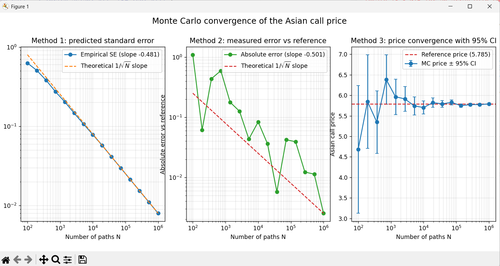

# Monte Carlo Pricing of an Arithmetic Asian Call Option

Monte Carlo pricer for an arithmetic-average Asian call option under the
risk-neutral measure, with full path simulation, a numerical consistency
check against the European price, and a three-panel convergence study.

## Overview

An **Asian option** has a payoff that depends on the **average** price of the
underlying over the life of the contract, not on the terminal price alone.
This single change has a deep consequence: unlike a European option, the Asian
payoff cannot be evaluated from the terminal value $S_T$ - it requires the
**entire price path**. This project simulates full Geometric Brownian Motion
trajectories, prices the option by Monte Carlo, and validates the result both
against financial intuition and through a detailed convergence analysis.

A key point motivating the whole project: **the arithmetic Asian option has no
closed-form price.** The arithmetic average of log-normal variables is not
itself log-normal, so no Black–Scholes-style formula exists. Monte Carlo is not
just convenient here — it is the natural pricing method.

## Theory in brief

**Payoff.** The arithmetic Asian call pays, at maturity $T$:

$$\text{payoff} = \max\left(\bar{S} - K,\ 0\right), \qquad \bar{S} = \frac{1}{m}\sum_{i=1}^{m} S_{t_i}$$

where the average is taken over the $m$ fixing dates $t_1, \dots, t_m$. The initial
price $S_0$ is known and non-random, so it is **not** a fixing date and is
excluded from the average.

**Path simulation.** Under the risk-neutral measure, the underlying follows a
Geometric Brownian Motion, simulated step by step over $\Delta t = T/m$:

$$S_{t_{i+1}} = S_{t_i}\exp\left(\left(r - \tfrac{1}{2}\sigma^2\right)\Delta t + \sigma\sqrt{\Delta t}\ Z_{i+1}\right), \qquad Z_i \sim \mathcal{N}(0,1)$$

The simulation is carried out in **log-space**: the multiplicative price
dynamics become additive on the log-price, so a full trajectory is obtained by
a cumulative sum of independent Gaussian increments, then a single
exponentiation. This keeps the code fully vectorised (an $N \times m$ matrix, no
Python loops).

A subtlety worth stating explicitly: the **increments** are independent, but the
**prices** across dates are **correlated**, because each price is built on top
of the previous one and shares the whole common history of the path. It is
precisely this temporal dependence that the Asian payoff samples — hence the
need to simulate the entire trajectory rather than a single terminal draw.

**Risk-neutral price.** By the law of large numbers, the discounted sample mean
of the payoffs converges to the risk-neutral expectation, which is the option
price:

$$C = e^{-rT}\ \mathbb{E}^{\mathbb{Q}}\left[\max\left(\bar{S} - K,\ 0\right)\right]$$

**Why the Asian is cheaper than the European.** With identical parameters, the
Asian call is worth **less** than the European call. The reason is *variance
reduction*, not payoff convexity: the average $\bar{S}$ is mechanically less
dispersed than the terminal price $S_T$ (correlated points, some at earlier and
lower-variance times). Since a call has positive vega — its convex payoff caps
losses at zero while keeping unlimited upside — lower effective volatility means
a lower price. This is a clean consistency test the code verifies numerically.

## Results

With `S0 = 100`, `K = 100`, `r = 5%`, `sigma = 20%`, `T = 1`, `m = 252` (daily
fixing), `N = 100,000`:

| Option              | Method               | Price   |
|---------------------|----------------------|---------|
| Asian call          | Monte Carlo          | 5.78    |
| European call       | Black–Scholes (closed-form) | 10.45 |

The Asian price sits well below the European one, confirming the
variance-reduction argument above. The gap is far larger than the Monte Carlo
standard error, so the inequality is unambiguous.

### Convergence study

Because there is no closed-form reference for the arithmetic Asian, convergence
is demonstrated three complementary ways in a single figure:



- **Method 1 — predicted standard error (left).** This does not measure a real
  error: it plots the *estimator* of the standard error,
  $\sigma_{\text{payoff}} / \sqrt{N}$, which predicts the estimator's own dispersion.
  Being an averaged, near-analytic quantity, it is **smooth** and follows the
  $1/\sqrt{N}$ law cleanly (fitted slope ~ −0.48).

- **Method 2 — measured error vs a high-resolution reference (middle).** Here a real
  error is measured: the absolute gap between the estimate $\hat{C}_N$ and a
  pseudo-truth obtained at very large $N$. Being a single random realisation per $N$,
  this curve
  **fluctuates** around the $1/\sqrt{N}$ line (fitted slope ~ −0.50). The
  contrast with Method 1 is intentional and instructive: one curve is a smooth
  *prediction* of precision, the other a noisy *measurement* of the error
  actually committed — two independent views of the same convergence law.

- **Method 3 — price convergence with 95% confidence bands (right, linear
  scale).** The Monte Carlo price is shown with shrinking $\pm 1.96\,\mathrm{SE}$
  bands that narrow towards the reference as $N$ grows. Every point stays consistent with
  the reference inside its confidence interval, so convergence is not only
  visual but statistically valid.

Two implementation notes behind these figures:

- **Reference price capped at $N = 2 \times 10^6$.** An $(N \times 252)$ float64 path
  matrix at $N = 10^7$ would require ~19 GB of RAM. $2 \times 10^6$ already yields a
  reference far more precise than the tested estimates, making it a sufficient
  pseudo-truth within the memory budget. (Reaching larger `N` would require
  batching the simulation.)

- **Independent seeds.** The reference uses a dedicated seed, and every tested
  estimate uses its own distinct seed. This independence is essential: if the
  reference and the estimates shared draws, their errors would be correlated and
  the measured convergence would be artificially biased.

## Usage

```bash
pip install -r requirements.txt
python Asian_Call_Pricing_GitHub_Project.py
```

Running the script prices the Asian call, prints the consistency check against
the European price, and generates the three-panel convergence figure
`convergence_three_panels.png`.

## Files

- `Asian_Call_Pricing_GitHub_Project.py` — path simulation, Asian pricing,
  numerical validation, and the convergence study.
- `convergence_three_panels.png` — three-panel convergence figure.
- `requirements.txt` — Python dependencies (`numpy`, `scipy`, `matplotlib`).
- `README.md` — this file.
